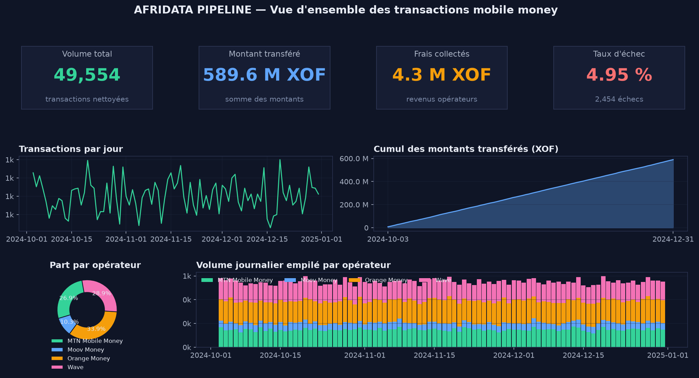
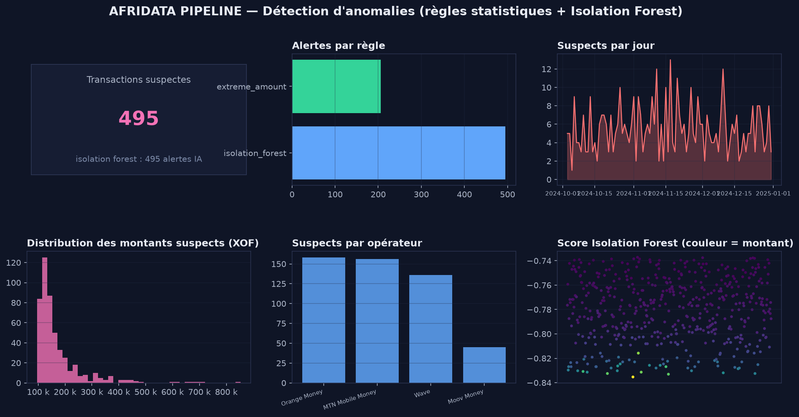
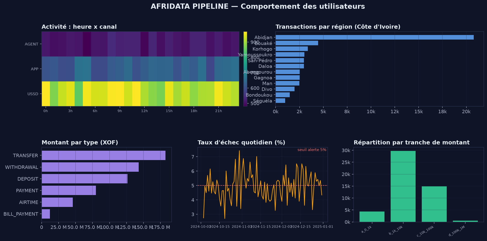

# Dashboard BI — AFRIDATA PIPELINE

Deux voies de restitution :

1. **Dashboard matplotlib (dépôt)** : les captures ci-dessous sont générées directement des tables Gold du lake, sans outil tiers : `python dashboard/generate_dashboard.py --lake data/lake_demo`.
2. **Dashboard Power BI (optionnel)** : connecte Power BI Desktop au warehouse PostgreSQL et suis le plan en bas de page.

## Page 1 — Vue d'ensemble



KPI globaux (volume, montant, frais, taux d'échec), évolution quotidienne, cumul des montants, part de marché par opérateur, volumes journaliers empilés par opérateur.

## Page 2 — Anomalies



Volume de transactions suspectes, alertes par règle (montants extrêmes, fréquences, paires répétées, Isolation Forest), suspects par jour/opérateur, distribution des montants et scores IA.

## Page 3 — Comportement des utilisateurs



Heatmap heure x canal, transactions par région de Côte d'Ivoire, montants par type de transaction, taux d'échec quotidien (seuil d'alerte 5 %), répartition par tranche de montant.

---

## Connexion Power BI (optionnel)

1. Power BI Desktop -> **Obtenir les données** -> PostgreSQL
2. Serveur : `localhost:5432`, base : `warehouse`
3. Importer les vues : `v_kpi_overview`, `v_daily_evolution`, `v_operator_performance`,
   `v_region_map`, `v_suspect_list`, `v_hourly_activity`, `v_daily_failures`.
4. Mesure DAX de base :

```DAX
Taux d echec % = DIVIDE(SUM(v_kpi_overview[total_failed]), SUM(v_kpi_overview[total_transactions]), 0)
```

### Pages du dashboard Power BI

| Page | Visuels |
| ---- | ------- |
| Vue d'ensemble | Cartes KPI (volume, montant, échec), anneau opérateurs, courbe journalière |
| Anomalies | Carte suspects, histogramme empilé par règle, nuage de points if_score vs amount, table détail |
| Comportement | Heatmap heure x canal, carte choroplèthe régions, barres types x tranches, alertes fail_rate |
